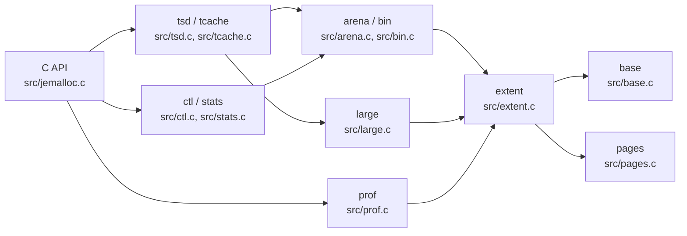

# 仓内模块依赖矩阵与影响面图谱

刻画仓内真实调用边与高扇入底座，供 Agent 评估改动波及范围。组件清单见 [组件技术架构总表](index.md)，隐式陷阱见 [高危雷区与历史陷阱](../operations/pitfalls-and-adr.md)。本仓为单仓工作区，不存在跨仓代码依赖。

## 1. 模块依赖拓扑图

## 2. 模块×模块真实调用边明细

| 调用方模块 | 被调方模块 | 耦合介质 | 契约符号 | 证据锚点 |
|---|---|---|---|---|
| `src/jemalloc.c` | `src/tcache.c` | 同步函数调用 | `tcache_alloc_small_hard` / `tcache_bin_flush_small` | `src/jemalloc.c:2335-2371`, `src/tcache.c:134` |
| `src/jemalloc.c` | `src/arena.c` | 同步函数调用 | `arena_init` / `arena_choose_hard` | `src/jemalloc.c:364`, `src/jemalloc.c:499` |
| `src/jemalloc.c` | `src/large.c` | 同步函数调用 | `large_malloc` | `src/large.c:14`, `src/jemalloc.c:1949` |
| `src/jemalloc.c` | `src/ctl.c` | 动态字符串分发 | `ctl_byname` | `src/jemalloc.c:3659`, `src/ctl.c:1292` |
| `src/jemalloc.c` | `src/prof.c` | 同步函数调用 | `prof_alloc_prep` / `prof_free` | `src/jemalloc.c:2116`, `src/jemalloc.c:2577` |
| `src/arena.c` | `src/extent.c` | 同步函数调用 | `extents_alloc` / `extents_evict` | `src/arena.c` 调用点见 `src/extent.c:537`, `:567` 定义 |
| `src/tcache.c` | `src/arena.c` | 同步函数调用 | `arena_slab_reg_dalloc` / `arena_tcache_fill_small` | `src/tcache.c:134`, `src/arena.c:1381` |
| `src/extent.c` | `src/pages.c` | 同步函数调用 | `pages_decommit` / `pages_unmap` | `src/pages.c:287`, `src/pages.c:241` |
| `src/extent.c` | `src/base.c` | 同步函数调用 | `base_alloc_extent` | `src/base.c:469` |
| `src/base.c` | `src/pages.c` | 同步函数调用 | `pages_map` / `pages_huge` | `src/pages.c:179`, `src/pages.c:360` |
| `src/background_thread.c` | `src/arena.c` | 同步函数调用 | `arena_decay_compute_purge_interval` | `src/background_thread.c:202` |
| `src/stats.c` | `src/ctl.c` | 同步函数调用 | `ctl_byname` 包装 | `src/stats.c:25-44` |

## 3. 变更爆炸半径与架构审计（Blast-Radius Audit）

- **高扇入核心底座（改签名必须全仓搜索调用点并跑全量单测）**：
  1. `src/jemalloc.c:2028` `imalloc_body` — 所有分配 API 的统一核心；改 `static_opts_t`/`dynamic_opts_t` 字段必须同步 `src/jemalloc.c:1864`, `:1899` 初始化与全部 20 个 API 入口（见 [api-reference](../contracts/api-reference.md)）。
  2. `src/extent.c:537` `extents_alloc` — small/large/metadata 三条供给路径共用；改返回值语义需复核 [extent 实体页](../business/domain-models/extent.md) 与 [OS 内存契约](../integrations/downstream/os-memory.md)。
  3. `src/pages.c:179` `pages_map` — OS 内存唯一入口；改参数将影响 mmap/DSS/THP 三条路径。
  4. `include/jemalloc/internal/sc.h:198-265` 尺寸类常量 — 决定所有档位、bin、slab 与快路径边界，见 [glossary](../overview/glossary.md)。
- **循环依赖与延迟导入**：`arena_init_locked`（`src/jemalloc.c:318`）与 `base_new`（`src/base.c:350`）在初始化期互相配合形成受控递归，靠 `malloc_init_a0`（`src/jemalloc.c:214`）绕过 TLS；此处不是函数内 `import`，而是 C 的初始化态守卫，改动须保持 `arena 0` 先就绪。
- **内嵌/跨进程边界**：本仓无 vendor 子仓；`bin/jeprof.in` 是独立 Perl 进程，通过读取堆转储文件与 jemalloc 解耦，边界见 [boundary](../operations/boundary.md)。

## 4. 跨仓依赖矩阵（`repo_deps`）

单仓模式，无跨仓代码依赖边。外部系统（OS 内核页管理、pthread、libc `secure_getenv`、Perl 解释器）均为仓库外黑盒，其本仓封装与参数见 [上下游集成总览](../integrations/index.md) 与 [认知边界](../operations/boundary.md)；不存在可填写 `repo/path:line` 证据的跨仓边。

## 5. 共变耦合与修改清单（Co-Change Playbook）

1. 改任一高扇入底座签名：按上节列出的调用点全量 `Grep` → 更新 [组件总表](index.md) 与相关 component 页 → 跑 `make tests && make check`。
2. 改 arena↔extent 或 extent↔pages 边界：同步 [extent-and-os](extent-and-os.md)、[wf-decay](../business/wf-decay.md)、[os-memory](../integrations/downstream/os-memory.md) → 跑 `test/unit/extent_util.c` 与 `test/unit/pages.c`。
3. 改 mallctl 分发：改 `src/ctl.c:622-636` 节点表 → 更新 [mallctl 命名空间](../contracts/api/mallctl.md) → 跑 `test/unit/mallctl.c`。
