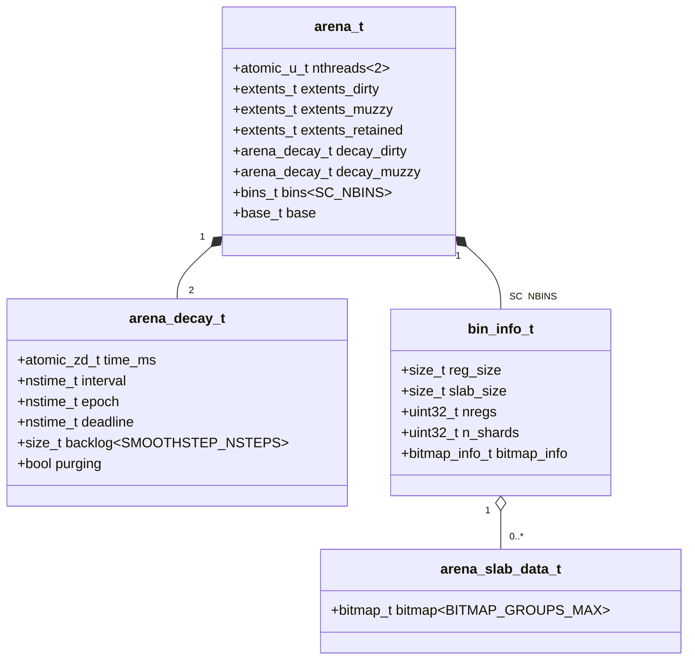

# arena 领域模型（arena）

本页展开 `arena_t` 的真实字段布局、初始化序列与 decay 子结构。路由见[领域模型索引](index.md)，消费方见[分配业务流](../wf-allocate.md)与[衰减业务流](../wf-decay.md)。

## 1. 字面核验与符号校正

| 任务符号 | 核验结论 | 字面锚点 |
| --- | --- | --- |
| `arena_t` | 存在，但**不在** `arena_structs_a.h` | `include/jemalloc/internal/arena_structs_b.h:77` `struct arena_s`；`include/jemalloc/internal/arena_types.h:18` typedef |
| `arena_slab_data_t` | 存在，唯一的 A 组结构 | `include/jemalloc/internal/arena_structs_a.h:6-9` 含 `bitmap_t bitmap[BITMAP_GROUPS_MAX]` |
| `arena_bin_info_t` | `[仓库内未找到字面实现]` | 全仓无此标识符；真实类型为 `bin_info_t`，见 `include/jemalloc/internal/bin.h:35-54` |
| `arena_new` | 存在 | `src/arena.c:1942` |

`bin_info_t` 的字面字段为 `reg_size`（`include/jemalloc/internal/bin.h:38`）、`slab_size`（`41`）、`nregs`（`44`）、`n_shards`（`47`）、`bitmap_info`（`53`），全局数组 `bin_infos[SC_NBINS]` 声明于 `include/jemalloc/internal/bin.h:56`。`src/arena.c:271` 的 `arena_slab_reg_alloc` 第三参数类型正是 `const bin_info_t *bin_info`。

## 2. 字段布局

`arena_decay_t` 定义于 `include/jemalloc/internal/arena_structs_b.h:17-75`，`arena_t` 定义于同文件 `77-219`。

| 字段 | 锚点 | 同步域／含义 |
| --- | --- | --- |
| `nthreads[2]` | `include/jemalloc/internal/arena_structs_b.h:91` | atomic；下标 0 应用分配、1 内部元数据（`77-90` 注释） |
| `binshard_next` | `:94` | atomic，新线程绑定的下一个 bin shard |
| `last_thd` | `:101` | percpu_arena 下缓存最近访问线程，减少 getcpu 调用 |
| `tcache_ql`／`tcache_ql_mtx` | `:113-115` | 聚合本 arena 的 tcache 统计 |
| `nactive` | `:147` | atomic，active extent 页数 |
| `large`／`large_mtx` | `:154-156` | 存活大对象链表 |
| `extents_dirty`／`extents_muzzy`／`extents_retained` | `:164-166` | 三级回收集合 |
| `decay_dirty`／`decay_muzzy` | `:174-175` | 分别负责 dirty→muzzy、muzzy→retained |
| `extent_avail`／`extent_avail_cnt`／`extent_avail_mtx` | `:200-202` | 空闲 `extent_t` 结构体池 |
| `bins[SC_NBINS]` | `:209` | 小对象 slab 堆集合 |
| `base`／`create_time` | `:216`／`:218` | 元数据分配器与 uptime 基准 |

`arena_decay_s` 的关键字段：`purging`（`:24`，防并发清除）、`time_ms`（`:30`，atomic）、`interval`（`:32`）、`epoch`（`:40`）、`jitter_state`（`:42`）、`deadline`（`:50`）、`nunpurged`（`:57`）、`backlog[SMOOTHSTEP_NSTEPS]`（`:64`）、`stats`（`:72`）、`ceil_npages`（`:74`，仅调试）。

## 3. 结构关系图

`~T~` 用于参数化定长数组：`nthreads~2~` 对应 `include/jemalloc/internal/arena_structs_b.h:91`，`backlog~SMOOTHSTEP_NSTEPS~` 对应 `:64`，`bins~SC_NBINS~` 对应 `:209`。

## 4. arena_new 初始化序列

`src/arena.c:1942` 的 `arena_new(tsdn, ind, extent_hooks)` 顺序如下：

| 步骤 | 锚点 | 行为 |
| --- | --- | --- |
| 选 base | `src/arena.c:1947-1954` | `ind==0` 用 `b0get()`；否则 `base_new`，失败返回 `NULL` |
| 算尺寸 | `src/arena.c:1956-1960` | 累加 `bin_infos[i].n_shards` 得 `nbins_total`，`arena_size = sizeof(arena_t) + sizeof(bin_t) * nbins_total` |
| 分配主体 | `src/arena.c:1961` | `base_alloc(tsdn, base, arena_size, CACHELINE)` |
| 线程计数归零 | `src/arena.c:1966-1968` | 两个 `nthreads` 与 `last_thd=NULL` |
| 统计初始化 | `src/arena.c:1970-1971` | `arena_stats_init` |

`LG_SLAB_MAXREGS`／`SLAB_MAXREGS` 定义于 `include/jemalloc/internal/arena_types.h:7-8`（`(LG_PAGE - SC_LG_TINY_MIN)` 与其 1 左移），决定单个 slab 可容纳的最大 region 数，进而约束 `arena_slab_data_t.bitmap` 的位宽。

## 5. decay 子结构与阈值

| 阈值 | 锚点 | 值／规则 |
| --- | --- | --- |
| `DIRTY_DECAY_MS_DEFAULT` | `include/jemalloc/internal/arena_types.h:11` | `ZD(10 * 1000)`，即 10000 ms |
| `MUZZY_DECAY_MS_DEFAULT` | `include/jemalloc/internal/arena_types.h:12` | `0`，muzzy 默认即时清除 |
| `DECAY_NTICKS_PER_UPDATE` | `include/jemalloc/internal/arena_types.h:14` | `1000`，事件 tick 到时间检查的换算 |
| `OVERSIZE_THRESHOLD_DEFAULT` | `include/jemalloc/internal/arena_types.h:49` | `(8 << 20)`，触发专用 huge arena 的下限，0 关闭 |
| deadline jitter | `src/arena.c:534-541` | `epoch + interval + Uniform[0, interval)`，仅 `decay_ms > 0` 时叠加 |
| 禁用判定 | `src/arena.c:719-727` | `decay_ms < 0` 不动作；`== 0` 全清；`> 0` 周期推进 |

`src/arena.c:916` 的 `arena_decay_to_limit` 在 `923-927` 行用 `purging` 标志串行化；`src/arena.c:787` 的 `arena_decay_ms_set` 在 `802-803` 行 `arena_decay_reinit` 后立刻 `arena_maybe_decay`。`arena_decay_t` 的 `backlog` 窗口长度由 `SMOOTHSTEP_NSTEPS` 决定（`include/jemalloc/internal/arena_structs_b.h:64`）。

## 6. 共变耦合与修改清单（Co-Change Playbook）

| 改动点 | 联动文件／符号 | 隐式陷阱 | 建议验证 |
| --- | --- | --- | --- |
| 改 `arena_s` 字段顺序 | `include/jemalloc/internal/arena_structs_b.h:77-219` → `src/arena.c:1960-1961` 的 `sizeof(arena_t)` | 热字段后移会增大 fastpath cacheline 数 | 基准测试对比 |
| 改 `bin_info_t` 字段 | `include/jemalloc/internal/bin.h:35-54` → `src/arena.c:271`／`287` → `src/arena.c:1958` 的 shard 求和 | `n_shards` 变化必须同步 `nbins_total`，否则分配越界 | shard 数边界单测 |
| 改 `arena_slab_data_t` 位图 | `include/jemalloc/internal/arena_structs_a.h:6-9` → `include/jemalloc/internal/extent_structs.h:173` → `src/arena.c:279` `bitmap_sfu` | 位图组数超过 `BITMAP_GROUPS_MAX` 会静默截断 | 最大 region 用例 |
| 改 decay 默认值 | `include/jemalloc/internal/arena_types.h:11-14` → `src/arena.c:719`／`534` | 默认值与 mallctl 校验范围不一致会导致启动即全清 | 配置矩阵测试 |

`arena_t` 两类消费者——分配与衰减——分别固定在[分配业务流](../wf-allocate.md)与[衰减业务流](../wf-decay.md)，字段语义变更须双向复核。
