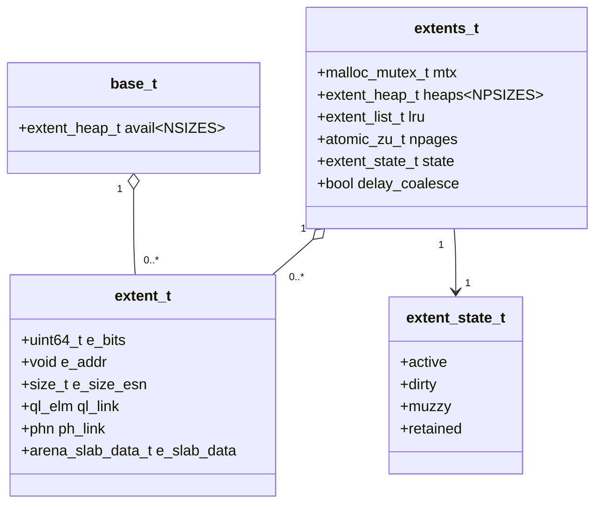

# extent 领域模型（extent）

本页展开 `extent_t` 的位打包布局、`extents_t` 的分级集合语义，以及分配／回收入口。路由见[领域模型索引](index.md)，调用方见[重分配业务流](../wf-realloc.md)与[extent 与 OS 架构](../../architecture/extent-and-os.md)。

## 1. 类型与状态字面核验

| 符号 | 定义锚点 | 说明 |
| --- | --- | --- |
| `extent_t` | `include/jemalloc/internal/extent_structs.h:20` `struct extent_s`；`include/jemalloc/internal/extent_types.h:4` typedef | 一段页跨度，字段经 accessor 访问 |
| `extents_t` | `include/jemalloc/internal/extent_structs.h:189` `struct extents_s`；`include/jemalloc/internal/extent_types.h:5` typedef | 按尺寸类量化的 extent 集合，内置 LRU |
| `extent_state_t` | `include/jemalloc/internal/extent_structs.h:12-17` | 四态枚举，值见下表 |
| `extents_alloc` | `src/extent.c:537` | 从集合回收或重用的入口 |

`include/jemalloc/internal/extent_types.h:16` 定义 `LG_EXTENT_MAX_ACTIVE_FIT_DEFAULT 6`：复用 active extent 时，新旧尺寸比的上限为 `1 << 6`，用于限制地址空间碎片。

## 2. extent_t 字段布局

`e_bits` 是 `include/jemalloc/internal/extent_structs.h:92` 的 `uint64_t` 位域打包，`35` 行注释给出从高位到低位的排布：sn → bin_shard → nfree → szind → state → zeroed → dumpable → committed → slab → arena_ind。掩码宏集中在 `:93-136`。

| 字段 | 锚点 | 含义 |
| --- | --- | --- |
| `e_bits` | `include/jemalloc/internal/extent_structs.h:92` | 十个元数据字段打包 |
| `e_addr` | `:139` | 该结构负责的内存起始地址 |
| `e_size_esn`／`e_bsize` | `:149`／`:153` | 联合：页对齐尺寸+序号／基础尺寸（可非页倍数） |
| `ql_link` | `:163` | 双链，用于 bin 的 slabs_full／extents LRU／大对象链表 |
| `ph_link` | `:169` | 堆链，用于按尺寸类的 sn／地址序堆与 extent_avail |
| `e_slab_data`／prof 联合 | `:171-182` | 小对象 slab 位图，或大对象的 `e_alloc_time`＋`e_prof_tctx` |

`e_bits` 内 `state` 占 2 位（`115-117`），恰好覆盖四种 `extent_state_t`；`szind` 宽度是 `LG_CEIL(SC_NSIZES)`（`119`），`nfree` 宽度由 `LG_SLAB_MAXREGS + 1` 决定（`123`），因此位宽与尺寸类配置强耦合。

## 3. 结构关系图

`~NPSIZES~`／`~NSIZES~` 对应 `include/jemalloc/internal/extent_structs.h:197-199` 的 `heaps[SC_NPSIZES + 1]` 与 base 侧按全尺寸类分级的堆，二者都以 `~T~` 表达按配置参数化的定长容器。

## 4. 状态机与集合不变式

| 状态 | 枚举值 | 字面锚点 | 含义 |
| --- | --- | --- | --- |
| `extent_state_active` | 0 | `include/jemalloc/internal/extent_structs.h:13` | 正在服务分配 |
| `extent_state_dirty` | 1 | `:14` | 已释放但页内容未 purge |
| `extent_state_muzzy` | 2 | `:15` | 已 lazy purge，仍保留映射 |
| `extent_state_retained` | 3 | `:16` | 已 forced purge，映射保留待复用 |

`extents_t` 的不变式来自 `include/jemalloc/internal/extent_structs.h:225`「所有存入的 extent 必须处于同一 state」：`state` 字段（`226`）即该集合的标签；`npages`（`223`）可在持 `mtx`（`190`）写入后无锁读取，但读者不得据此推断其余字段一致（`216-222` 注释）。`delay_coalesce`（`232`）决定合并发生在释放时还是逐出时。

| 字段 | 锚点 | 同步规则 |
| --- | --- | --- |
| `heaps`／`nextents`／`nbytes` | `include/jemalloc/internal/extent_structs.h:197-199` | 持 `mtx` |
| `bitmap` | `:206` | 置位表示对应堆非空，持 `mtx` |
| `lru` | `:213` | 全部堆内 extent 的 LRU 队列，持 `mtx` |
| `npages` | `:223` | 修改持 `mtx`，读取可无锁 |

## 5. extents_alloc 与回收链

`src/extent.c:537` 的 `extents_alloc(tsdn, arena, r_extent_hooks, extents, new_addr, size, pad, alignment, slab, szind, zero, commit)` 在 `545-546` 行直接转 `extent_recycle`，并在 `547` 行断言返回的 extent 可 dump。它不直接调用 OS，而是优先复用集合内地址空间。

| 入口 | 锚点 | 关键规则 |
| --- | --- | --- |
| `extents_alloc` | `src/extent.c:537` | `size + pad != 0`、`alignment != 0`（`540-541`） |
| `extents_dalloc` | `src/extent.c:552` | 复位 `e_addr`（`560`）、`zeroed=false`（`561`），再 `extent_record`（`563`） |
| `extents_evict` | `src/extent.c:567` | 从 `lru` 取最早项（`581`）；`npages <= npages_min` 即停（`586-591`） |
| `extent_deregister` | `src/extent.c:878` | 转 `extent_deregister_impl(..., true)`（`879`） |
| `extent_purge_forced_impl` | `src/extent.c:2035` | hook 为空返回 `true`（`2043-2045`）；否则调用 `purge_forced`（`2049-2051`） |
| `extents_fit_alignment` | `src/extent.c:406` | 用 `bitmap_ffu` 从 `pind` 起扫描尺寸堆（`411-414`），按 `PAGE_CEILING(alignment)` 判断可用（`422-424`） |

`src/extent.c:611-623` 的逐出状态分支：dirty/muzzy 仅把 extent 标为 `active`（`616`），retained 则 `extent_deregister`（`619`）以摘除 rtree 映射，防止并发查找命中已复用地址。

## 6. 共变耦合与修改清单（Co-Change Playbook）

| 改动点 | 联动文件／符号 | 隐式陷阱 | 建议验证 |
| --- | --- | --- | --- |
| 改 `e_bits` 字段宽度 | `include/jemalloc/internal/extent_structs.h:93-136` → `include/jemalloc/internal/extent_types.h:4` → 全部 accessor | 掩码溢出会截断 `szind` 或 `sn`，且无编译错误 | 最大尺寸类与序号回绕用例 |
| 改四态枚举值 | `include/jemalloc/internal/extent_structs.h:12-17` → `src/extent.c:611-623` 的 switch | 持久化／hook 侧看到的是整数值，改值破坏兼容 | 状态机穷举测试 |
| 改 `npages` 同步 | `include/jemalloc/internal/extent_structs.h:223` → `src/extent.c:586` | 无锁读取不能推断其他字段，误用会导致逐出错误 extent | 并发逐出压测 |
| 改复用比例 | `include/jemalloc/internal/extent_types.h:16` → `extents_fit_alignment`（`src/extent.c:406`）→ `extents_alloc`（`537`） | 比值放宽会增加内部碎片，收紧会降低复用率 | 地址空间占用对比 |
| 改 forced purge 调用 | `src/extent.c:2043-2051` → `extents_evict`（`619`） | hook 返回 `true` 表示失败，上层需决定是否放弃 | 自定义 hook 故障注入 |

extent 与 OS 的实际映射边界见[extent 与 OS 架构](../../architecture/extent-and-os.md)，本页只维护结构语义与集合不变式。
