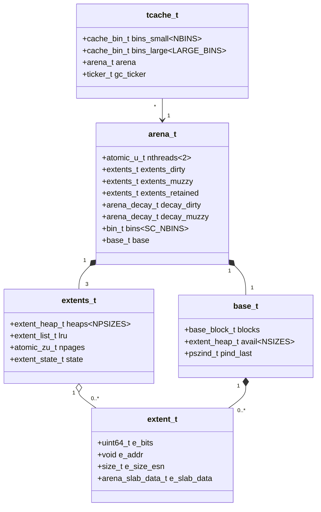

# 领域模型索引（domain-models-index）

本页是 jemalloc 四个核心内存结构的路由入口：[arena](arena.md) 管区域与尺寸类，[extent](extent.md) 管页跨度与 OS 映射，[tcache](tcache.md) 管线程级缓存，base 管元数据自身的分配。调用侧语义见[业务总览](../index.md)。

## 1. 四个核心类型

| 类型 | 结构定义锚点 | typedef 锚点 | 职责 |
| --- | --- | --- | --- |
| `arena_t` | `include/jemalloc/internal/arena_structs_a.h:6` 仅定义 `arena_slab_data_s`，`arena_t` 本体 `[仓库内未找到字面实现]` 于该文件 | `include/jemalloc/internal/arena_structs_b.h:77` `struct arena_s`；`include/jemalloc/internal/arena_types.h:18` `typedef struct arena_s arena_t` | 绑定线程、持有 bins、三组 extents 与两组 decay |
| `extent_t` | `include/jemalloc/internal/extent_structs.h:20` `struct extent_s` | `include/jemalloc/internal/extent_types.h:4` | 一段页跨度，承载 slab 位图或大对象 prof 元数据 |
| `tcache_t` | `include/jemalloc/internal/tcache_structs.h:13` `struct tcache_s` | `include/jemalloc/internal/tcache_types.h:6` | 每线程缓存栈，热字段前置 |
| `base_t` | `include/jemalloc/internal/base_structs.h:20` `struct base_s` | `include/jemalloc/internal/base_types.h:5` `typedef struct base_s base_t` | arena 元数据的自举分配器 |

`arena_structs_a.h` 的全部内容为 `include/jemalloc/internal/arena_structs_a.h:6-9`：一个 `bitmap_t bitmap[BITMAP_GROUPS_MAX]` 字段，即 slab 的 per-region 位图。把它列入本页是因为 `extent_t` 的 `e_slab_data` 联合成员（`include/jemalloc/internal/extent_structs.h:171-182`）直接内嵌该结构，构成 arena 与 extent 的交界。

## 2. 类型关系图

`~T~` 语法用于表达按尺寸类数量参数化的定长数组，例如 `arena_t` 的 `bins`（`include/jemalloc/internal/arena_structs_b.h:209`）、`tcache_t` 的 `bins_small`（`include/jemalloc/internal/tcache_structs.h:28`）与 `base_t` 的 `avail`（`include/jemalloc/internal/base_structs.h:49`）。

## 3. 所有权与生命周期

| 结构 | 创建者 | 销毁／归还 | 同步域 |
| --- | --- | --- | --- |
| `arena_t` | `src/arena.c:1942` `arena_new`；`base_alloc` 在 `1961` 分配主体 | 随 arena reset／销毁 | 各字段独立，见 `include/jemalloc/internal/arena_structs_b.h:89-216` 注释 |
| `extent_t` | `extents_alloc`（`src/extent.c:537`）→ `extent_recycle`（`545`） | `extents_dalloc`（`src/extent.c:552`）／`extent_deregister`（`878`） | `extents_t.mtx`（`include/jemalloc/internal/extent_structs.h:190`） |
| `tcache_t` | `src/tcache.c:486` `tcache_create_explicit`，`498` `ipallocztm` | `src/tcache.c:546` `tcache_destroy`，先 `tcache_flush_cache` | 线程私有，arena 侧用 `tcache_ql_mtx`（`include/jemalloc/internal/arena_structs_b.h:115`）聚合 |
| `base_t` | `include/jemalloc/internal/base_structs.h:20` 定义的实例由 `base_new` 初始化 | `base_unmap` 释放块 | `base_s.mtx`（`include/jemalloc/internal/base_structs.h:31`） |

`base_block_s` 位于 `include/jemalloc/internal/base_structs.h:9-18`，其 `extent` 字段（`17`）把元数据块也纳入统一的 extent 抽象，因此 `base_t` 与 `extent_t` 之间存在结构内嵌而非仅指针引用。

## 4. 状态字段速查

| 字段 | 锚点 | 取值／含义 |
| --- | --- | --- |
| `extent_state_t` | `include/jemalloc/internal/extent_structs.h:12-17` | `active=0`、`dirty=1`、`muzzy=2`、`retained=3` |
| `e_bits` | `include/jemalloc/internal/extent_structs.h:92` | 打包 arena_ind／slab／committed／dumpable／zeroed／state／szind／nfree／binshard／sn |
| `cache_bin_sz_t` | `include/jemalloc/internal/cache_bin.h:22` | `int32_t`，负值编码 `low_water` 耗尽态 |
| `tcache` 哨兵 | `include/jemalloc/internal/tcache_types.h:14-17` | `DISABLED=1`、`REINCARNATED=2`、`PURGATORY=3` |
| decay 默认值 | `include/jemalloc/internal/arena_types.h:11-14` | `DIRTY_DECAY_MS_DEFAULT=10000`、`MUZZY_DECAY_MS_DEFAULT=0`、`DECAY_NTICKS_PER_UPDATE=1000` |

## 5. 共变耦合与修改清单（Co-Change Playbook）

| 改动点 | 联动文件／符号 | 隐式陷阱 | 建议验证 |
| --- | --- | --- | --- |
| 改 `arena_s` 字段布局 | `include/jemalloc/internal/arena_structs_b.h:77` → `src/arena.c:1942` → 本索引 classDiagram | 热字段顺序变化影响 cache 局部性，且 `base_alloc` 尺寸计算在 `1960-1961` 依赖 `sizeof(arena_t)` | 重新测量 alloc 基准 |
| 改 `e_bits` 位宽 | `include/jemalloc/internal/extent_structs.h:93-136` → `include/jemalloc/internal/extent_types.h:4` → 所有 accessor | 位宽溢出会静默截断 `arena_ind` 或 `sn` | 位域边界单测 |
| 改 `tcache_t` 热区 | `include/jemalloc/internal/tcache_structs.h:13-28` → `src/jemalloc.c:2335` 的 `tsd_tcachep_get` | 把冷字段移入热区会增大 fastpath 工作集 | 对照 perf cache-miss 计数 |
| 改 `base_s.avail` 分级 | `include/jemalloc/internal/base_structs.h:49` → `src/arena.c:1961` | 分级过粗导致元数据碎片化 | 元数据占用统计 |

四个模型的具体字段展开分别见[arena](arena.md)、[extent](extent.md)与[tcache](tcache.md)；本索引不重复维护字段副本。
