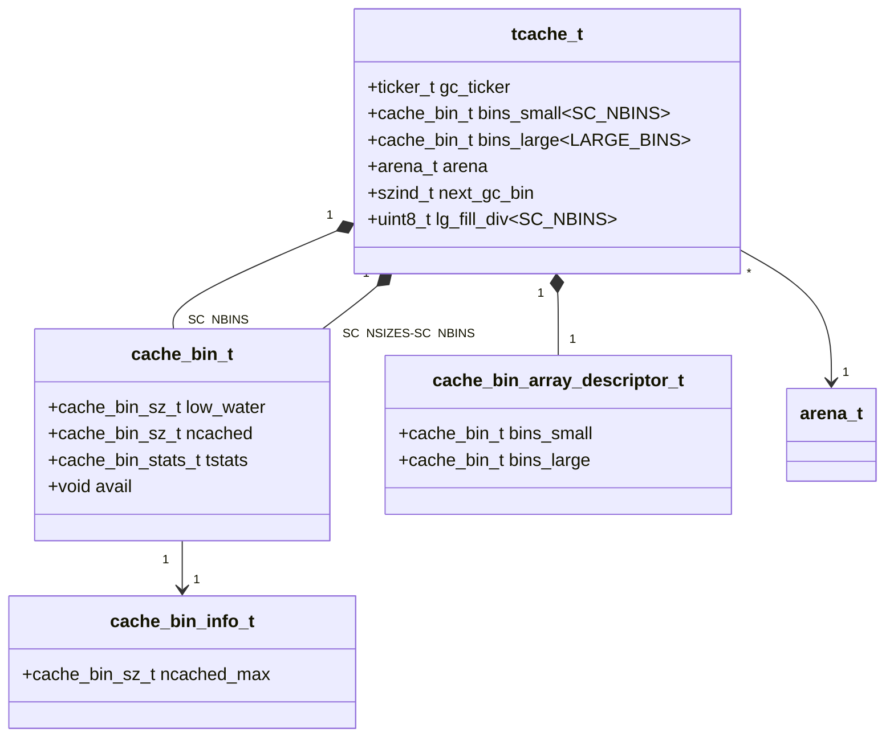

# tcache 领域模型（tcache）

本页展开线程级缓存 `tcache_t`、通信载体 `cache_bin_t` 与冲刷原子 `tcache_bin_flush_small`。路由见[领域模型索引](index.md)，调用方见[释放业务流](../wf-deallocate.md)与[tcache 与 TSD 架构](../../architecture/tcache-and-tsd.md)。

## 1. 类型与阈值字面核验

| 符号／常量 | 定义锚点 | 值／含义 |
| --- | --- | --- |
| `tcache_t` | `include/jemalloc/internal/tcache_structs.h:13` `struct tcache_s`；`include/jemalloc/internal/tcache_types.h:6` typedef | 每线程缓存容器 |
| `cache_bin_t` | `include/jemalloc/internal/cache_bin.h:43-65` | 单个尺寸类的空闲指针栈 |
| `tcache_bin_flush_small` | `src/tcache.c:134`（`55` 为调用点） | 小类批量冲刷 |
| `TCACHE_NSLOTS_SMALL_MIN` | `include/jemalloc/internal/tcache_types.h:22` | `20`，小类槽位绝对下限 |
| `TCACHE_NSLOTS_SMALL_MAX` | `include/jemalloc/internal/tcache_types.h:31` | `200`，必须为偶数 |
| `TCACHE_NSLOTS_LARGE` | `include/jemalloc/internal/tcache_types.h:34` | `20`，大类槽位 |
| `LG_TCACHE_MAXCLASS_DEFAULT` | `include/jemalloc/internal/tcache_types.h:37` | `15`，决定 `tcache_maxclass` |
| `TCACHE_GC_SWEEP` | `include/jemalloc/internal/tcache_types.h:44` | `8192`，两次完整 GC 间的近似分配次数 |
| `TCACHE_GC_INCR` | `include/jemalloc/internal/tcache_types.h:47-48` | `TCACHE_GC_SWEEP / SC_NBINS` 向上取整 |

`include/jemalloc/internal/tcache_types.h:14-17` 用接近 NULL 的指针编码状态：`TCACHE_STATE_DISABLED=1`、`REINCARNATED=2`、`PURGATORY=3`、`TCACHE_STATE_MAX=PURGATORY`。

## 2. tcache_t 字段布局

`include/jemalloc/internal/tcache_structs.h:13-60` 把热字段放在结构头部（`14-17` 注释）。

| 字段 | 锚点 | 作用 |
| --- | --- | --- |
| `prof_accumbytes` | `include/jemalloc/internal/tcache_structs.h:20` | 累积采样字节，`arena_prof_accum` 后清零 |
| `gc_ticker` | `:22` | 驱动增量 GC |
| `bins_small[SC_NBINS]` | `:28` | 小类指针栈，紧邻热区 |
| `link`／`tsd_link`／`in_hook` | `:35`／`:38`／`:39` | arena 链表、TSD 链表、hook 重入标记 |
| `cache_bin_array_descriptor` | `:46` | 让 arena 在不依赖 tcache 定义的前提下聚合统计 |
| `arena` | `:49` | 绑定的 arena |
| `next_gc_bin`／`lg_fill_div[SC_NBINS]` | `:51`／`:53` | 轮转 GC 位置与小类填充除数 |
| `bins_large[SC_NSIZES-SC_NBINS]` | `:59` | 大类栈，放结构尾部节约页触碰 |

`tcaches_s`（`include/jemalloc/internal/tcache_structs.h:63-68`）是显式 tcache ID 的空闲链表，`tcache_t*` 与 `tcaches_t*` 共用联合；`include/jemalloc/internal/tcache_types.h:57` 的 `TCACHES_ELM_NEED_REINIT` 表示已冲刷但未销毁。

## 3. cache_bin_t 的栈语义

`include/jemalloc/internal/cache_bin.h:44-65` 定义 `cache_bin_t`：`low_water`（`:46`，自上次 GC 以来最小缓存数）、`ncached`（`:48`）、`tstats`（`:54`，`nrequests` 见 `:25-31`）、`avail`（`:64`）。`cache_bin_sz_t` 是 `int32_t`（`:22`），负值编码「缓存耗尽」态。

指针栈向下生长：`avail` 指向可用区上方，`avail[-ncached, ..., -1]` 为有效项，最低地址项最先分配（`include/jemalloc/internal/cache_bin.h:55-63` 注释）。

| 操作 | 锚点 | 失败条件 |
| --- | --- | --- |
| `cache_bin_alloc_easy(bin, success)` | `include/jemalloc/internal/cache_bin.h:87-117` | `ncached == -1` 时置 `success=false` 返回 `NULL`（`99-103`） |
| `cache_bin_dalloc_easy(bin, bin_info, ptr)` | `include/jemalloc/internal/cache_bin.h:119-129` | `ncached == ncached_max` 时返回 `false`（`121-123`） |
| `cache_bin_array_descriptor_init` | `:79-85` | 无，仅链接两个栈数组 |

`cache_bin_info_t`（`include/jemalloc/internal/cache_bin.h:37-41`）只保存 `ncached_max`，与可变字段分离以节省内存（`33-36` 注释）。

## 4. 结构关系图

`~SC_NBINS~` 与 `~SC_NSIZES-SC_NBINS~` 对应 `include/jemalloc/internal/tcache_structs.h:28` 与 `:59` 的定长数组，`~1~` 外的基数来自 `include/jemalloc/internal/cache_bin.h:75-76` 的 descriptor 双指针。

## 5. 冲刷与补货规则

`src/tcache.c:134` 的 `tcache_bin_flush_small(tsd, tcache, tbin, binind, rem)` 在 `143` 行算 `nflush = ncached - rem`；`152` 行用 `iealloc` 查每个指针的 extent；`156-206` 行按 arena/binshard 分组加锁，`174` 行取 `bin->lock`，`189` 行调 `arena_dalloc_bin_junked_locked` 归还。跨 shard 项暂存于 `ndeferred`（`198-201`），下一轮处理。

| 触发 | 锚点 | 规则 |
| --- | --- | --- |
| 增量 GC，小类 | `src/tcache.c:55-57` | `rem = ncached - low_water + (low_water >> 2)`；随后 `lg_fill_div++`（`63-65`） |
| 增量 GC，大类 | `src/tcache.c:68-69` | `tcache_bin_flush_large`，不改 fill_div |
| `low_water < 0` | `src/tcache.c:71-78` | 小类且 `lg_fill_div > 1` 时 `lg_fill_div--` |
| 轮转 | `src/tcache.c:80-85` | `low_water = ncached`，`next_gc_bin` 到 `nhbins` 回零 |
| 补货 | `src/tcache.c:89-99` | `tcache_alloc_small_hard` → `arena_tcache_fill_small`（`94`）→ `cache_bin_alloc_easy`（`99`） |
| 显式 flush | `src/tcache.c:512-530` | 全部小类 `rem=0`（`517`）、大类 `rem=0`（`525`） |
| 收尾 | `src/tcache.c:221-223` | `memmove` 把剩余 `rem` 项搬到栈顶并写回 `ncached` |

`src/tcache.c:486` 的 `tcache_create_explicit` 用 `ipallocztm`（`498`）从 arena 0 分配，`506` 行 `tcache_arena_associate` 绑定；`src/tcache.c:546` 的 `tcache_destroy` 先 `tcache_flush_cache` 再释放。

## 6. 共变耦合与修改清单（Co-Change Playbook）

| 改动点 | 联动文件／符号 | 隐式陷阱 | 建议验证 |
| --- | --- | --- | --- |
| 改 `ncached_max` 生成 | `include/jemalloc/internal/cache_bin.h:40` → `include/jemalloc/internal/tcache_structs.h:28`／`:59` → `src/tcache.c:121` | 上限变化需重算 `stack_nelms`，否则 `avail` 越界写 | 最大填充压测 |
| 改 `low_water` 语义 | `include/jemalloc/internal/cache_bin.h:46` → `src/tcache.c:55`／`80` | 负值编码依赖 `cache_bin_sz_t` 有符号，改类型即破坏耗尽检测 | `ncached == -1` 单测 |
| 改 GC 折半 | `src/tcache.c:63-65`／`76-77` → `src/arena.c:1394` 补货量 | 增减不对称导致某些 bin 长期不补货 | 逐 bin 请求计数 |
| 改 descriptor | `include/jemalloc/internal/cache_bin.h:67-77` → `src/arena.c` 的 tcache 统计聚合 | arena 侧不能依赖 tcache 定义，新增字段会破坏解耦 | 关闭 tcache 的统计对照 |
| 改规模宏 | `include/jemalloc/internal/tcache_types.h:22-48` → 配置解析与 `MALLOC_CONF` 校验 | 宏改变需同步配置边界，否则启动期断言 | 配置矩阵启动测试 |

tcache 的 TSD 绑定与线程退出清理见[tcache 与 TSD 架构](../../architecture/tcache-and-tsd.md)，本页仅维护结构与冲刷语义。
