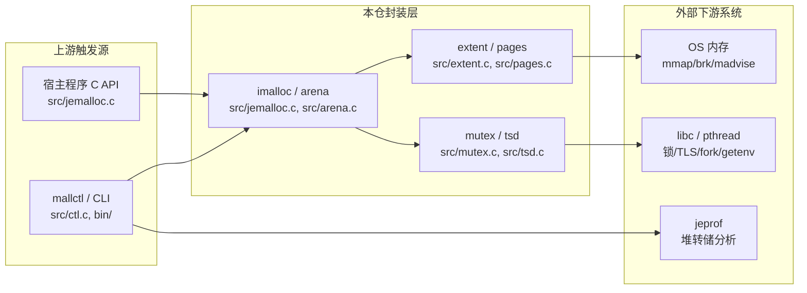

# 上下游集成与调用拓扑总览

jemalloc 不调用网络服务，也没有 HTTP/RPC 下游：本仓「上游」是宿主程序与诊断工具，「下游」是 OS 内核内存管理、pthread/libc 运行时与 Perl 分析器。全部下游均为仓库外黑盒，本仓只包含参数组装与返回解包层。字段级变换见 [参数组装与字段映射](topology-and-mapping.md)，系统分层见 [系统技术架构](../overview/system-architecture.md)。

## 1. 上下游调用拓扑图

## 2. 仓内组件「上游有谁 ↔ 下游调谁」双向速查表

| 本仓组件 | 源码路径 | 直接上游调用方 | 调用的仓内下游模块 | 调用的外部下游封装 | 组件架构页 |
|---|---|---|---|---|---|
| 分配核心 | `src/jemalloc.c`, `src/arena.c` | 宿主程序 `malloc/calloc/realloc` (`src/jemalloc.c:2323`, `:2474`, `:2653`) | `src/tcache.c`, `src/large.c`, `src/extent.c` | libc（[libc-runtime](downstream/libc-runtime.md)） | [allocator-core](../architecture/allocator-core.md) |
| extent 供给 | `src/extent.c`, `src/base.c` | `src/arena.c`, `src/large.c` | `src/pages.c`, `src/extent_mmap.c`, `src/extent_dss.c` | OS 内存（[os-memory](downstream/os-memory.md)） | [extent-and-os](../architecture/extent-and-os.md) |
| 线程缓存 | `src/tcache.c`, `src/tsd.c` | `src/jemalloc.c:2335` | `src/arena.c`, `src/rtree.c` | pthread TLS（[libc-runtime](downstream/libc-runtime.md)） | [tcache-and-tsd](../architecture/tcache-and-tsd.md) |
| 控制面 | `src/ctl.c`, `src/stats.c` | mallctl 调用方、`bin/jemalloc-config.in` | `src/arena.c:83` 统计聚合 | 无外部网络下游 | [control-and-observability](../architecture/control-and-observability.md) |
| profiler/后台 | `src/prof.c`, `src/background_thread.c` | 采样阈值触发 / 后台定时器 | `src/extent.c`, `src/stats.c` | Perl 堆分析器（[boundary](../operations/boundary.md)） | [profiler-and-background](../architecture/profiler-and-background.md) |

## 3. 外部下游依赖系统全量清单（Downstream Registry）

| 下游系统名 | 承担职责 | 协议与成功判定 | 底层调用点 | 本仓业务封装文件（参数组装层） | 超时/重试 | 契约专页 |
|---|---|---|---|---|---|---|
| OS 内存 | 映射/解映射/提交/清除/THP 页 | 系统调用返回 `-1` + `errno` 为失败 | `src/pages.c:179` `pages_map`, `:241` `pages_unmap`, `:287` `pages_decommit` | `src/pages.c`, `src/extent_mmap.c:22`, `src/extent_dss.c:110` | 无超时/重试语义，错误向上冒泡 | [os-memory.md](downstream/os-memory.md) |
| libc / pthread | 锁、TLS、fork 回调、env 读取、输出与 abort | 返回 0 成功；`EAGAIN`/`EINVAL` 等 errno | `src/mutex.c:135` `malloc_mutex_init`, `src/tsd.c:270` `tsd_fetch_slow`, `src/jemalloc.c:712` `jemalloc_secure_getenv` | `src/mutex.c`, `src/tsd.c`, `src/jemalloc.c:1584-1586` | 锁竞争由 spin/witness 控制，无网络超时 | [libc-runtime.md](downstream/libc-runtime.md) |

本仓**无** HTTP/DB/MQ 下游服务，也不存在需要硬编码的内部平台地址；配置只经 `MALLOC_CONF` 与构建参数进入（见 [配置手册](../contracts/configuration.md)）。

## 4. 跨仓依赖与黑盒边界

单仓模式，`repo_deps` 为空。OS 内核对 mmap/madvise 的真实调度策略、pthread 实现细节、Perl 解释器行为均不在本仓，严禁猜测；本仓已核实的仅是 [参数与返回字典](../integrations/topology-and-mapping.md) 及 [认知边界声明](../operations/boundary.md)。

## 5. 共变耦合与修改清单（Co-Change Playbook）

1. 给 OS 下游新增参数：改 `src/pages.c:179` 的参数组装 → 核对 [os-memory](downstream/os-memory.md) 请求表 → 更新 [topology-and-mapping](topology-and-mapping.md) 的字段映射 → 跑 `test/unit/pages.c`。
2. 改线程/锁边界：改 `src/mutex.c:135` 或 `src/tsd.c:270` → 同步 [libc-runtime](downstream/libc-runtime.md) → 跑 `test/unit/mtx.c` 与 `test/unit/background_thread.c`。
3. 新增外部下游：先在本页注册表与拓扑图登记，再在 `integrations/downstream/` 下建独立专页，禁止只改底座不写契约。
