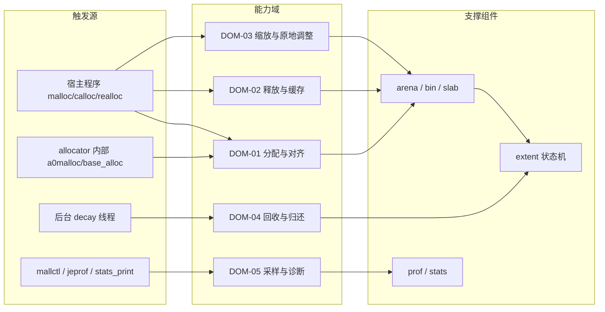

# 业务架构全景

本仓的「业务」是内存生命周期能力，而非订单/审批类业务：触发方是宿主程序的分配调用、allocator 自身元数据分配、后台 decay 线程与诊断工具。端到端闭环为「请求 → 档位映射 → arena/tcache 取块 → 释放回归 extent → decay 归还 OS → 统计/采样输出」。全量流程索引见 [业务能力与核心流程总清单](../business/index.md)，状态实体见 [领域模型总览](../business/domain-models/index.md)。

## 1. 角色触发源与业务域拓扑

## 2. 业务域边界与能力矩阵

| 业务域标识 | 业务域名称 | 核心职责 | 核心状态实体 | 归属代码模块 | 准入/配额约束 | 关联业务清单 |
|---|---|---|---|---|---|---|
| `DOM-01` | 分配与对齐 | 把 size/flags 映射为 `szind_t` 并从 tcache/bin/large 取块 | `arena_t`, `tcache_t` | `src/jemalloc.c`, `src/arena.c`, `src/tcache.c`, `src/large.c` | `usize <= SC_LARGE_MAXCLASS`；对齐必须是 2 的幂 | [业务流程总表](../business/index.md) |
| `DOM-02` | 释放与缓存 | 经 rtree 反查 size/slab 标志，回收进 tcache 或 extent | `extent_t` | `src/jemalloc.c`, `src/tcache.c`, `src/extent.c` | 指针必须已注册于 `extents_rtree` | [wf-deallocate](../business/wf-deallocate.md) |
| `DOM-03` | 缩放与原地调整 | realloc/rallocx/xallocx 的原地扩张、搬迁与语义兼容 | `extent_t` | `src/jemalloc.c`, `src/large.c`, `src/rtree.c` | `size==0` 等价释放；搬迁失败保留原块 | [wf-realloc](../business/wf-realloc.md) |
| `DOM-04` | 回收与归还 | dirty/muzzy decay 与后台线程把页归还 OS | `extent_state_t` | `src/arena.c`, `src/background_thread.c`, `src/extent.c` | `dirty_decay_ms == -1` 表示禁用自动 decay | [wf-decay](../business/wf-decay.md) |
| `DOM-05` | 采样与诊断 | 分配采样、堆转储、统计输出与 mallctl 读 | `prof_tdata_t` | `src/prof.c`, `src/stats.c`, `src/ctl.c` | `opt_prof` / `config_prof` 编译开关 | [wf-profile](../business/wf-profile.md) |

## 3. 全量业务流程主索引（`WF-*`）

| 流程 ID | 流程名称 | 触发入口 | 串联组件（按执行序） | 关键状态迁移 | 流程专页 |
|---|---|---|---|---|---|
| `WF-01` | 分配 | `je_malloc` (`src/jemalloc.c:2323`), `je_calloc` (`:2474`), `je_mallocx` (`:3098`) | `tcache → sz → arena/bin/slab / large → extent` | 无归属 → active | [wf-allocate.md](../business/wf-allocate.md) |
| `WF-02` | 释放 | `je_free` (`src/jemalloc.c:2863`), `je_dallocx` (`:3487`) | `rtree → tcache → arena_slab_reg_dalloc → extent_deregister` | active → dirty/muzzy | [wf-deallocate.md](../business/wf-deallocate.md) |
| `WF-03` | 缩放 | `je_realloc` (`src/jemalloc.c:2653`), `je_rallocx` (`:3216`) | `rtree → isalloc → iralloct → large_ralloc` | active → active / 搬迁后 active | [wf-realloc.md](../business/wf-realloc.md) |
| `WF-04` | decay 回收 | `arena_maybe_decay` (`src/arena.c:714`), `background_work` (`src/background_thread.c:483`) | `arena decay → extents_evict → pages_purge/decommit → pages_unmap` | dirty → muzzy → retained → 释放 | [wf-decay.md](../business/wf-decay.md) |
| `WF-05` | 采样与统计 | `prof_sample_threshold_update` (`src/prof.c:1140`), `je_malloc_stats_print` (`src/jemalloc.c:3708`) | `prof_alloc_prep → prof_dump` / `ctl → stats_print` | 采样计数回绕 → 转储文件 | [wf-profile.md](../business/wf-profile.md) |

## 4. 全局业务不变量（不可破坏的红线）

1. **档位不变量**：所有用户请求必须先转 `szind_t`，`ind >= SC_NSIZES` 直接 OOM；校验锚点 `src/jemalloc.c:2061-2065`。
2. **对齐不变量**：`alignment` 必须是 2 的幂且不超过 `SC_LARGE_MAXCLASS`，非法跳 `label_invalid_alignment`；校验锚点 `src/jemalloc.c:2054-2057`。
3. **重入不变量**：slow path 且 `tsd_reentrancy_level > 0` 时强制 `tcache=NONE, arena=0`，避免内部分配递归锁死；校验锚点 `src/jemalloc.c:2096-2108`。
4. **指针归属不变量**：释放路径必须用 `rtree_szind_slab_read` 从 `extents_rtree` 反查 alloc ctx，禁止调用方自报 size；校验锚点 `src/jemalloc.c:2570-2572`。
5. **配置闭合不变量**：非法 `MALLOC_CONF` 键值在 `opt_abort_conf` 下 abort，禁止静默忽略；校验锚点 `src/jemalloc.c:1432-1434`。
6. **fork 安全不变量**：prefork 逐 arena 持锁、postfork 子进程重初始化锁；注册锚点 `src/jemalloc.c:1584-1586`。

## 5. 共变耦合与修改清单（Co-Change Playbook）

1. 新增流程：在 [业务流程总表](../business/index.md) 登记 `WF-*` 并建专页 → 同步本页拓扑与不变量 → 更新 [调用链全景](../overview/callchain-panorama.md)。
2. 改任一业务域准入条件：按域反查 `src/jemalloc.c:2054-2108`（分配）、`src/jemalloc.c:2570-2591`（释放）、`src/arena.c:714-803`（decay）→ 更新对应 WF 专页的规则表 → 跑 `make check`。
3. 改 arena/extent 状态实体：同步 [领域模型总览](../business/domain-models/index.md) 与 [extent 实体页](../business/domain-models/extent.md) → 跑 `test/unit/extent_util.c`。
