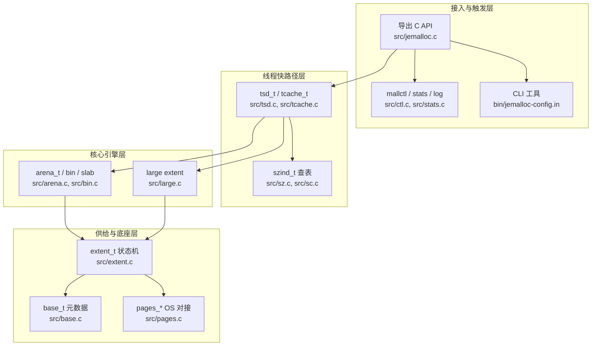

# 系统技术架构

jemalloc 是同进程内嵌的 C 库，无独立进程、无网络服务：导出 C API 与 mallctl 命名空间，经 tcache/arena/bin/slab 分层把用户请求落到 OS 页。分层红线是「用户对象分配不得直接触发系统调用，必须经 extent 层；元数据分配不得走用户 tcache」。逐组件细节见 [组件技术架构总表](../architecture/index.md)，OS 边界见 [上下游集成总览](../integrations/index.md)。

## 1. 运行时分层与依赖拓扑



| 架构层 | 包含目录 / 文件 | 核心职责 | 越界禁令（Agent 修改红线） |
|---|---|---|---|
| 接入与触发层 | `src/jemalloc.c`, `src/ctl.c`, `src/stats.c`, `bin/` | 导出 C 符号、mallctl 树、诊断输出 | 禁止在 API 入口直接调 `mmap`/`brk` |
| 线程快路径层 | `src/tsd.c`, `src/tcache.c`, `src/sz.c`, `src/sc.c` | TLS 状态、无锁 bin、尺寸类查表 | 快路径禁止引入互斥锁或动态分配 |
| 核心引擎层 | `src/arena.c`, `src/bin.c`, `src/large.c` | slab reg 分配、large 分配、decay 状态机 | 禁止耦合 CLI / mallctl 表示层对象 |
| 供给与底座层 | `src/extent.c`, `src/base.c`, `src/pages.c`, `src/extent_mmap.c`, `src/extent_dss.c` | extent 注册/回收、元数据 bump 分配、OS 页操作 | 外部页大小与 THP 能力一律运行时探测，禁止硬编码 |

## 2. 进程启动装配与停机序列（Bootstrap Call Tree）

```text
jemalloc_constructor (src/jemalloc.c:3774) / 首次 malloc -> malloc_init (src/jemalloc.c:222)
  └─ malloc_init_hard (src/jemalloc.c:1733)
       ├─ [1. 尺寸类] sc_data_init (src/sc.c:312) -> sz_boot (src/sz.c:60) -> bin_infos_init
       ├─ [2. 配置] malloc_conf_init (src/jemalloc.c:1440) -> 4 源解析，MALLOC_CONF 最后生效
       ├─ [3. TLS] tsd_boot1 (src/tsd.c:436) -> 每线程 tcache/arena 绑定
       ├─ [4. arena] arena_init_locked (src/jemalloc.c:318) -> arena_new (src/arena.c:1942)
       │    └─ base_new (src/base.c:350) 分配 arena/bin_t 元数据
       ├─ [5. 后台] background_thread_create (src/background_thread.c:593) 受 opt_background_thread 控制
       ├─ [6. 控制面] ctl_init (src/ctl.c:1118) 注册 mallctl 节点树
       └─ [7. fork] pthread_atfork (src/jemalloc.c:1584-1586) 注册 prefork/postfork 三钩子
```

停机侧由 `stats_print_atexit`（`src/jemalloc.c:647`）在 `opt_stats_print` 开启时输出统计；`jemalloc_prefork`（`src/jemalloc.c:3781`）按 arena 逐把加锁，`jemalloc_postfork_child`（`src/jemalloc.c:3894`）在子进程重初始化锁，避免 fork/初始化竞态。

## 3. 跨切面工程机制速查表

| 机制维度 | 核心符号与源码锚点 | 全局实现规则 |
|---|---|---|
| 配置优先级 | `obtain_malloc_conf` (`src/jemalloc.c:938`) | `--with-malloc-conf` → 全局 `malloc_conf` → `/etc/malloc.conf` 链接名 → `MALLOC_CONF` 环境变量；逐条覆盖同键（全表见 [配置手册](../contracts/configuration.md)） |
| 并发与锁 | `malloc_mutex_lock` (`include/jemalloc/internal/mutex.h:217`) | arena/bin/extent 各自持锁；tcache 快路径无锁；witness 校验锁序 |
| 线程生命周期 | `tsd_fetch_slow` (`src/tsd.c:270`), `tsd_do_data_cleanup` (`src/tsd.c:363`) | 每线程 tcache/arena/prof 状态在线程退出时清理，arena 绑定计数回退 |
| 后台回收 | `arena_maybe_decay` (`src/arena.c:714`), `background_work` (`src/background_thread.c:483`) | dirty/muzzy 依据 `dirty_decay_ms`/`muzzy_decay_ms` 推进；`-1` 表示禁用自动 decay |
| 错误与降级 | `malloc_abort_invalid_conf` (`src/jemalloc.c:898`), `safety_check_fail` (`src/safety_check.c:10`) | 配置非法按 `abort_conf` 决定 abort；size mismatch 触发 safety check（全表见 [错误码字典](../contracts/error-codes.md)） |
| 外部边界 | `pages_map` (`src/pages.c:179`), `extent_alloc_mmap` (`src/extent_mmap.c:22`) | 页大小与 overcommit 运行时探测；OS 内核行为属 [外部黑盒](../operations/boundary.md) |

## 4. 共变耦合与修改清单（Co-Change Playbook）

1. 改启动顺序：必须保持 `sc_data_init` → `sz_boot` → `bin_infos_init` → `arena_new` → `ctl_init` 的依赖序（`src/sc.c:312`, `src/sz.c:60`, `src/arena.c:1942`, `src/ctl.c:1118`），颠倒会导致档位查表为空。
2. 新增 arena 内状态字段：同步 `include/jemalloc/internal/arena_structs_b.h` 与 `src/arena.c:83` `arena_stats_merge`、[arena 实体页](../business/domain-models/arena.md)，并跑 `make check`。
3. 改 OS 对接参数：改 `src/pages.c:179` → 核对 [OS 内存下游契约](../integrations/downstream/os-memory.md) 的参数表 → 跑 `test/unit/pages.c` 对应套件。
4. 改配置解析：改 `src/jemalloc.c:1170-1414` → 同步 [配置手册](../contracts/configuration.md) → 跑 `test/unit/mallctl.c`。
